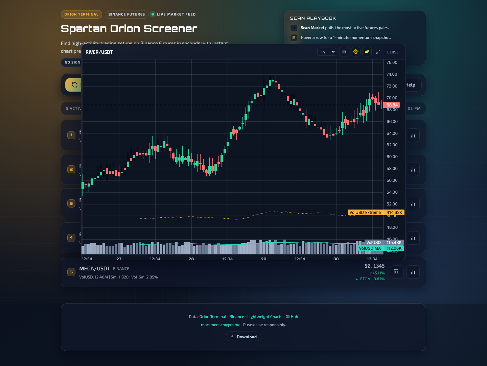

# Spartan Orion Screener

Single-file market scanner for Binance USDT-M perpetual futures. It scans Binance directly, ranks the strongest candidates, shows instant chart previews, and shares compact social cards without signup or API keys. GitHub Pages hosts the production demonstration build.

**[Launch App](https://mars-llm.github.io/orionterminal-spartan/)** · [Download HTML](https://raw.githubusercontent.com/mars-llm/orionterminal-spartan/main/index.html) · [GitHub](https://github.com/mars-llm/orionterminal-spartan)



## What You Get

- One-click scans with ranked `Top 1-3` candidates and metric tooltips
- `New` badges highlight setups absent from the previous successful scan with the same filters; comparisons stay in memory and reset when the page reloads
- Instant chart previews plus a larger modal with S/R overlays, MA, volume, funding, and open interest
- Built-in presets for high-volume markets, lower-volume markets, scalping activity, and the default flow
- Settings for chart appearance, display behavior, and CORS/proxy management
- Social-card-only sharing for either the current top setups or the active filter state
- PWA install support and a downloadable `index.html` for local use

## Quick Start

1. Open the [live production demonstration build](https://mars-llm.github.io/orionterminal-spartan/) or download `index.html`.
2. Click **Scan Market**.
3. Wait for the market checks to finish, then hover a result row for the chart preview or expand it for the full modal.
4. Use **Share Social Card** to create a visual share link.

If the browser restricts requests when opening `index.html` from `file://`, serve the folder locally and open it in the browser:

```bash
python3 -m http.server 8000
```

Install as an app from Chrome/Edge via the install icon, or from iOS Safari via **Share -> Add to Home Screen**.

Optional web fonts load without blocking the first visible page. If they are slow or unavailable, the app uses system fonts. The browser's deferred-install-banner notice is informational; use the app's Install button to request installation.

## Sharing

- Sharing is social-card-only. Setup-link sharing is intentionally not part of the product anymore.
- If results exist, the card captures the top setups. If results are empty, it captures the active filter thresholds.
- Supported URLs are `?card=<payload>` and `?view=social-card&card=<payload>`.
- New links use compact `v2` payloads. Legacy `v1` payloads still decode.
- Cards expire after 3 days and expired cards are explicitly blocked.
- There is no backend storage; the full card payload lives in the URL.
- Social-card URLs are public by design, so never add private details to shared captions, filters, or derived metadata.

## Market coverage

- Scans use Binance's active, USDT-quoted and USDT-margined perpetual contracts directly. They do not depend on Orion's preview, sign-in, or a CORS proxy.
- Rolling 24h volume is Binance quote volume in USDT. The 5m activity filter uses the number of trades in the latest closed 5m candle. The 15m range is `(highest high / lowest low - 1) * 100` across the latest three closed 5m candles. These are explicit candle-based metrics, not replicas of Orion's calculations.
- Volume bounds, symbol inclusion/exclusion, and the available 24h trade count narrow the market list before candle requests. Binance's bulk ticker endpoint does not support a server-side volume predicate: the app fetches it once and filters locally. A 24h trade count below the requested 5m minimum rules a market out; the app never treats an average 24h rate as current 5m activity.
- Each scan checks at most 20 markets, ordered by 24h volume or 24h trade count. The optional symbol list accepts up to 20 base assets or USDT pairs; exclusions take priority. 5m activity and 15m range thresholds apply after this selection, so a focused scan can have fewer results even when other markets outside its shortlist would qualify. The coverage notice and setup cards identify this scope.
- Presets use the same filter pipeline: Default excludes the six configured majors; High Volume Majors uses a 50M USDT minimum; Lower Volume uses the 100K-10M USDT band, not market capitalization; Scalping selects the most-traded matching markets and requires 500 trades in the latest closed 5m candle. A preset is a filter configuration, not a promise of results or trading quality.
- A cold scan makes at most 23 requests (three bulk/metadata requests and 20 candle requests), with two concurrent candle requests and a 90-second overall deadline. Bulk tickers and server time are cached for one minute; candles are reused within their closed 5m window, and exchange metadata for ten minutes. Immediate repeats with the same market selection need no new requests. Scan completion does not automatically prefetch funding or open interest.
- Scans have a local ceiling of 30 requests per rolling minute. The shared ceiling for all Binance requests is 60, including charts and encoded proxy targets. Optional funding, open-interest and S/R requests stop when only 20 slots remain, preserving capacity for candles. A blocked scan reports the wait until enough slots are available for its whole uncached batch. The budget and provider cooldown survive reloads and are shared across same-origin tabs, using Web Locks where available. If browser storage or locking is unavailable, protection falls back to the current tab. This is a client-side limit, not a guarantee against provider blocks or traffic from other apps/devices sharing an IP.
- Chart previews load only after the configured hover delay or an explicit open action; passing over a card starts no market request. A compact preview requests candles only (plus any S/R overlays explicitly enabled in Settings). Funding and open interest load after candles in the expanded detail view. Identical pending candle, S/R and extra requests share their network work, caller cancellation is isolated, and reopening a cached chart does not fetch candles again within the cache TTL. Fresh cached charts, including labelled spot fallbacks, remain usable when the network budget is exhausted.
- Timeframe changes settle for 150ms before loading; a new selection or closing the chart cancels pending work. Older responses cannot replace the active chart. On touch screens, chart gestures do not expand the preview, scrolling does not open cards, and viewport or header-size changes resize the canvas without fetching market data. Use the header's Expand control for the detail view.
- Closed-candle metrics can lag by up to six minutes including the one-minute summary cache. The 1h and 4h changes use complete 12- and 48-candle windows; missing longer windows are unavailable, not reported as zero.
- Missing market data produces a visible incomplete-scan notice, including on setup social cards. Rate-limit and regional-access responses stop the scan; they are not bypassed through proxies. Retry is user-triggered rather than automatically replaying a full batch.
- USDC, delivery, inactive, and conflicting base-asset/symbol markets are excluded. Displayed results still obey the selected result limit.

## Development

This is a single-file-first frontend app centered on `index.html`.

```bash
npm install
npm run sync:build-meta
npm test
```

Useful commands:

- `npm run test:e2e` runs the local Playwright suite.
- `npm run test:e2e:live` runs the live GitHub Pages gate.
- `npm run test:coverage` writes browser coverage summaries to `coverage/`.
- `npm run test:social-card` focuses on social-card regressions.

## Deployment Verification

- `npm run sync:build-meta` generates `build-meta.json`.
- The app exposes build metadata in the footer, on the root HTML element, and through `window.__ORION_BUILD_INFO__`.
- Runtime checks can verify `data-app-build`, `data-build-date`, `data-card-payload-version`, `data-service-worker-cache`, `data-runtime-channel`, and `data-build-source`.
- Public build metadata must stay release-safe: never expose local paths, usernames, tokens, or other private machine details.

## Data Sources

- [Binance Futures](https://www.binance.com) for the market universe, rolling tickers, candles, funding, and open interest
- Binance Vision, Coinbase, and Kraken as chart fallbacks when needed
- Configurable proxies for chart fallbacks and legacy diagnostics only; market scans never use them
- [Lightweight Charts](https://tradingview.github.io/lightweight-charts/) for chart rendering

MIT License
